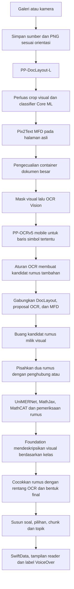

# Audit pipeline aktif — build 45

**Catatan historis:** dokumen ini merekam build45. Kebijakan kandidat dan penerimaan rumus pada source build50 dijelaskan di [FORMULA-POLICY-AUDIT.md](FORMULA-POLICY-AUDIT.md).

Tanggal: 28 Oktober 2026. Cakupan: impor produksi galeri/kamera sampai reader dan VoiceOver. Dibaca langsung dari kode dan dibandingkan dengan artefak run `c91a8fac-6736-4a43-8d29-5ed8be74e9f5` di iPhone 16 Pro Max. Audit ini tidak mengubah perilaku aplikasi.

Dokumen ini menginventarisasi aturan aplikasi dan lokasi implementasinya. Aturan internal MathCAT adalah kumpulan YAML bawaan tersendiri; inventaris file dan hash-nya disertakan dalam `pipeline-audit-build45-sources.json`, bukan disalin ulang sebagai aturan buatan Metra. Bobot model terlatih juga bukan aturan eksplisit yang dapat didaftar sebagai if/else.

## 1. Alur eksekusi sebenarnya

Urutan di atas penting: ini bukan hanya tiga cabang Text/Formula/Visual yang independen. OCR teks dapat membuat kandidat rumus baru, dan sesudah MathCAT berhasil masih ada pemeriksaan penggabungan yang dapat menahan ucapan.

## 2. Model dan runtime

| Komponen | Peran aktif | Batas/konfigurasi |
|---|---|---|
| PP-DocLayout-L | Kotak dan kelas layout | ONNX CPU, FP32, 2 thread; input 640×640; score >0,5; NMS IoU kelas sama 0,6 / berbeda 0,98 |
| MathVisualRepresentationClassifier | Klasifikasi crop visual | Core ML, computeUnits all, Vision scaleFit RGB 360×360; kelas graph/diagrams/geometry/others; ambil prediksi tertinggi, tanpa ambang penerimaan tambahan |
| Pix2Text MFD | Tambahan deteksi kotak rumus | ONNX CPU FP32, 2 thread; lebar target 768, sisi maksimum 1536, stride 32; score ≥0,25; NMS kelas sama >0,7; maksimal 300 deteksi |
| Apple Vision OCR | Teks dan kotak karakter | accurate; koreksi bahasa off; id-ID dan en-US hanya jika didukung OS; simpan 5 kandidat per observasi |
| PP-OCRv5 mobile recognizer | Pendamping simbol pada baris Vision tertentu | Bukan detector teks halaman; maksimal 80 baris yang memenuhi pemicu |
| UniMERNet tiny | Crop rumus menjadi LaTeX | ONNX FP32; tensor grayscale 192×672; greedy; maksimum 512 token; tenggat decoder 30 detik; harus mencapai EOS |
| MathJax lokal | LaTeX menjadi MathML | WKWebView; timeout startup/konversi 15 detik; satu permintaan aktif; merror ditolak |
| MathCAT 0.7.5 | MathML menjadi teks ucapan | id, ClearSpeak, Medium, TTS=None, desimal koma, pemisah ribuan titik/spasi; fixed native thread |
| Foundation system model | Deskripsi gambar visual | On-device image-only; sesi baru per visual; greedy, 1536 token, timeout 60 detik; tanpa cloud fallback |

Produksi memakai `serial_baseline`: satu halaman sekaligus. HeavyInferenceGate membatasi tahap berat menjadi satu sekaligus. Model dimuat/dilepas bertahap; cache hasil ekstraksi tidak aktif. Pembatalan menyimpan hasil parsial; resume run melewati halaman yang sudah tersimpan. Ini berbeda dari caching hasil model.

Sumber: `OnDeviceExtractionService.swift`, `RunCoordinator.swift`, adapter masing-masing model, serta konfigurasi dalam Resources.

## 3. Aturan input dan layout

| ID audit | Aturan aktif | Efek |
|---|---|---|
| I01 | Simpan byte sumber dan SHA-256; buat PNG normalisasi orientasi | Tidak melakukan deskew, super-resolution, atau rekonstruksi generatif |
| I02 | Kamera dikodekan JPEG kualitas 0,95 oleh jalur kamera | Byte yang diterima disimpan; jangan diasumsikan identik dengan file kamera asli |
| L01 | Filter score dan NMS PP-DocLayout | Kotak di bawah ambang atau duplikat dapat hilang dari daftar aktif; raw tetap tersimpan |
| L02 | Parent layout dari kotak yang lebih besar dan mencakup ≥95% kotak anak | Mempertahankan struktur bersarang, termasuk rumus |
| L03 | Urut baca dasar ymin lalu xmin, tie-break deterministik | Heuristik geometri, bukan model reading order multi-kolom |
| L04 | `dense_document_container_v1` | Visual ≥60% area halaman dapat dialihkan menjadi container teks bila ≥12 baris OCR, ≥8 baris prosa, ≥600 huruf, dan ≤1 region teks lain di dalamnya |

L04 adalah pengecualian terhadap image-only: satu OCR halaman tanpa mask boleh dijalankan untuk menilai container dokumen besar. Hasilnya tidak dikirim ke Foundation sebagai bukti gambar. Baris prosa untuk keputusan ini minimal 35 karakter dan 25 huruf. Kelas/crop asli dicatat.

## 4. Aturan visual dan deskripsi

Classifier **tidak dijalankan untuk semua kelas selain Text/Formula**. Pemicu aktualnya hanya label visual: `image`, `diagram`, `figure`, `chart`, `header_image`, `footer_image`, `seal`. Judul, header/footer teks, tabel, dan kelas layout lain mempunyai perlakuan tersendiri. Struktur sel tabel belum didukung.

| ID audit | Aturan aktif | Efek |
|---|---|---|
| V01 | `visual_image_only_routing_v1`: perluas crop dari gambar asli | Margin horizontal 4% lebar, vertikal 12% tinggi, masing-masing dibatasi 16–48 px; batasi sebelum prosa tetangga |
| V02 | `math_visual_classifier_v1`: ambil kelas argmax | Probabilitas disimpan; belum ada ambang confidence terkalibrasi |
| V03 | Others → skip; klasifikasi tidak tersedia → skip/error | Tidak membuat deskripsi Foundation untuk Others atau kelas yang tidak diketahui |
| V04 | Mask kotak visual putih untuk OCR teks; buang observasi yang dimiliki visual | Kepemilikan VisualImageRoute memakai overlap ≥60% area observasi/kandidat |
| V05 | Buang formula/formula_candidate yang parent-nya visual atau dimiliki visual | Label/rumus di dalam gambar dijelaskan dari gambar; tidak dikirim terpisah ke UniMERNet/MathCAT |
| V06 | `foundation_diagram_image_only_v8` | Hanya crop asli, kelas classifier, prompt dan guideline; tanpa OCR/MathCAT/candidate pendamping |
| V07 | Graph | Sebut jenis grafik, sumbu bila ada, label dan nilai per butir, koordinat memakai “koma”; jangan mengarang sumbu diagram lingkaran atau menghitung tren |
| V08 | Diagrams | Uraikan bagian yang terlihat dalam butir pendek, eja satuan lengkap; tidak mengajarkan konsep/menjawab soal |
| V09 | Geometry | Kalimat singkat dan spesifik, titik/garis/tanda, urut kiri ke kanan; hubungan tanpa penanda tidak disimpulkan |
| V10 | Struktur keluaran overview + parts(location, labels, values, appearance) + unreadableDetails | Angka hanya pada panel tempat angka terlihat; teks gambar diperlakukan sebagai data, bukan instruksi |
| V11 | Validasi hasil: nonkosong dan ≤6000 karakter; format baris/butir; tambah bagian tidak jelas | Tidak ada validator independen yang membuktikan akurasi label, angka, atau relasi visual |

Deskripsi image-only yang mempunyai ketidakpastian tetap bisa dibacakan dengan status partial. Itu berbeda dari filter rumus. Model yang tidak tersedia/gagal menghasilkan preview “Deskripsi gambar belum tersedia.”

Sumber utama: `VisualImageRoute.swift`, `MathVisualClassifier.swift`, `FoundationDiagramService.swift`, `FoundationDiagramRuntime.swift`, `FoundationImageTextLayout.swift`, `DiagramSpokenService.render` dalam `DiagramProbeService.swift`.

## 5. Aturan OCR pendamping

| ID audit | Aturan aktif | Efek |
|---|---|---|
| O01 | OCR pada halaman dengan visual dimask | Teks bukan selalu dikenali satu per satu pada kotak Text; pengenalan utama adalah halaman kerja |
| O02 | PP-OCRv5 hanya untuk baris dengan pemicu sudut, derajat, superskrip, atau pola pangkat yang rusak | Membatasi jumlah permintaan, maksimum 80 baris |
| O03 | `paddle_unicode_symbol_selection_v3`: karakter nonspasi harus sejajar dan berjumlah sama | Perubahan prosa/angka di luar confusion set menolak penggantian satu baris |
| O04 | Penggantian simbol eksplisit dengan probabilitas per simbol ≥0,70 | Confusion set: L/Z→∠; o/O/0/º/petik→°; 2/r/г/petik/?→²; 3/r/г/petik/?→³ |
| O05 | Simbol baru harus berada dalam notasi lengkap yang didukung UnicodeMathSource | Bukan koreksi bebas semua hasil OCR; spasi dan geometri tetap berasal dari Vision |
| O06 | Perbandingan mengenali bentuk full-width; homoglyph label pilihan hanya pada konteks marker | Tidak mengubah seluruh alfabet atau kalimat secara global |

Sumber: `VisionOCRAdapter.swift`, `PaddleOCRService.swift`, `PaddleMathSymbolSelector.swift`, `PaddleOCRCTC.swift`.

## 6. Semua sumber kandidat rumus aktif

Selain kotak Formula dari PP-DocLayout dan kotak Pix2Text MFD, `OCRMathROIProposer.propose` masih aktif dan membuat kandidat baru dari OCR teks. Aturan satuan bermasalah **belum dinonaktifkan** pada build 45.

| ID audit | Nama kebijakan | Yang dicari / dihasilkan |
|---|---|---|
| P01 | `pp_doclayout_l` | Kotak kelas formula dari layout |
| P02 | `pix2text_mfd_image_proposal_v1` | Kotak embedding/isolated dari detector MFD, masuk sebagai formula_candidate |
| P03 | `vision_range_math_proposal_v1` | Huruf Latin tunggal dan tuple numerik bertanda kurung, misalnya x atau (3.000, 2.000) |
| P04 | `vision_math_expression_proposal_v1` | Ekspresi OCR yang mempunyai huruf, angka/operator tertentu; panjang >1 dan ≤160; pola bisa memicu kandidat sebelum pengenalan memastikan isinya |
| P05 | `vision_degree_literal_proposal_v1` | Angka dengan tanda ° atau º eksplisit |
| P06 | `vision_degree_expression_proposal_v1` | Ekspresi derajat bertanda kurung, misalnya (x + 20)° |
| P07 | `vision_length_unit_power_proposal_v1` | Angka + mm/cm/dm/m/dam/hm/km + suffix pangkat eksplisit, datar, atau rusak |
| P08 | `ocr_unicode_math_proposal_v3` | Notasi lengkap yang mengandung ∠ ° superskrip ≤ ≥ ≠ × ÷ ±; bukan substitusi bebas L/Z menjadi ∠ |

Aturan bersama proposal:

- Memerlukan kotak karakter/range Vision yang sah; rentang UTF-16 asli disimpan.
- Jika sudah overlap dengan Formula PP-DocLayout ≥15% area proposal, gunakan jalur Formula yang ada.
- Proposal dengan IoU >0,8 terhadap proposal sebelumnya tidak digandakan.
- Huruf tunggal yang kotaknya terlalu lebar ditolak; crop glyph diperketat ke komponen foreground terbesar beserta komponen vertikal terkait seperti titik i/j.
- Ekspresi memakai margin minimal 3 px atau 25% tinggi. Unicode/satuan memakai horizontal minimal 2 px atau 5% tinggi, vertikal minimal 3 px atau 25% tinggi. Jalur lainnya umumnya 1 px.
- Proposal Unicode diutamakan daripada proposal legacy yang bertumpang tindih. Prioritas juga menghindari pemecahan ekspresi/derajat/satuan menjadi kandidat huruf yang lebih kecil.
- Tanda titik/koma/titik koma setelah notasi Unicode hanya ikut jika glyph terakhir dan tanda baca benar-benar berbagi kotak Vision yang identik.

**Mengapa rupiah salah:** regex P07 mengizinkan suffix rusak berupa 1–3 huruf setelah satuan. Potongan `000,00 maka` dapat dibaca sebagai angka `000,00` + satuan `m` + suffix `aka`. Ini bukan keputusan PP-DocLayout dan bukan classifier visual.

`vision_visual_numeric_proposal_v2` dan pembacaan angka di visual masih ada dalam kode lama. Namun visual dimask/dikeluarkan dari working OCR sehingga jalur angka visual tersebut tidak digunakan pada jalur image-only normal. Jalur derajat literal P05 masih aktif dan dapat melewati UniMERNet/MathJax: angka literal OCR → MathML presentasi → MathCAT.

## 7. Aturan penggabungan kandidat detector

`supplemental_mfd_crop_merge_v4` dalam `FormulaCropMerger.swift`:

| ID audit | Keputusan |
|---|---|
| M01 | Pertahankan Formula PP-DocLayout bila mencakup ≥15% area kotak MFD; MFD tidak membuat bacaan kedua |
| M02 | Tahan kandidat MFD yang overlap ≥80% area kotak lebih kecil dengan MFD aktif sebelumnya |
| M03 | Fusi hanya jika ada tepat satu proposal sumber lengkap yang didukung: satuan, ekspresi, atau Unicode |
| M04 | Fusi memakai kedekatan ≥80%; syarat rentang utuh: ≥85% raw source tercakup dan IoU ≥0,4; ada pengecualian unitPart yang tetap memerlukan near dan rasio area ≥0,15 |
| M05 | Union crop tidak boleh menambah glyph OCR luar rentang sumber yang tercakup ≥50% |
| M06 | Overlap ambigu dengan proposal Vision → pertahankan Vision, jangan tambah MFD |
| M07 | MFD di visual → tidak dipakai sebagai rumus independen |
| M08 | Satu hint OCR berupa angka biasa, huruf/marker daftar, atau token satuan → jangan membuat gap formula baru |
| M09 | Area tanpa konflik → tambah gap crop MFD, tetapi masih harus melewati pengenalan dan alignment |

Score antar-model tidak dibandingkan sebagai ukuran kebenaran yang sama. Raw detector dan crop asli tetap disimpan.

## 8. Pemisahan kata “atau”

`source_connector_formula_split_v2` dalam `CompoundFormulaSplitter.swift`:

- Hanya satu kata “atau” eksplisit pada observasi OCR; observasi overlap ≥70% dan tinggi region ≤2,2× tinggi baris.
- Kiri dan kanan harus dua ekspresi pendek: masing-masing ≤80 karakter, ≤12 huruf, dan mempunyai penanda persamaan/perbandingan atau pola operator yang didukung.
- Harus ada kotak glyph terpisah di kiri, penghubung, dan kanan. Kotak bersama yang tidak menyediakan batas aman tidak dipotong.
- Batas crop disesuaikan ke celah tanpa tinta selebar minimal 3 kolom, threshold grayscale 200, pencarian radius minimal 8 px atau 0,35× tinggi band.
- Kedua rumus dikenali sendiri; “atau” tetap teks. Proposal yang terliput ≥85% dipensiunkan agar tidak mengganti sumber dua kali.
- Pemeriksaan hasil: anchor huruf Latin selain x/X harus sama, karakter awal sama, tepat satu “=”, dan hasil tidak mengandung “atau”. Pemeriksaan ini tidak membuktikan seluruh pecahan/angka benar.

## 9. Pengenalan, perubahan turunan, dan penahanan bacaan

| ID audit | Aturan aktif | Bisa menahan bacaan? |
|---|---|---|
| F01 | Crop asli dipakai; pita prosa terdeteksi di bagian atas crop dapat dikeluarkan bila menyisakan ≥2 baris OCR | Dapat mengubah crop pengenalan; raw dipertahankan |
| F02 | UniMERNet: hasil harus tidak kosong dan mencapai EOS; maksimum 512 token / 30 detik decoder | Ya |
| F03 | `tex_numeric_whitespace_compaction_v1`: rapatkan whitespace di antara digit/tanda desimal untuk transport MathJax | Tidak mengubah digit atau mengganti separator; LaTeX raw disimpan |
| F04 | MathJax: hasil merror, startup/konversi gagal, atau timeout → gagal | Ya |
| F05 | Error ack WKWebView unsupported-result-type saja diabaikan; hasil MathML tetap harus datang lewat request-ID postMessage | Mencegah kegagalan teknis palsu; bukan meloloskan MathML gagal |
| F06 | MathCAT wajib menghasilkan respons sukses dan spokenText nonkosong; aturan id/ClearSpeak harus tersedia | Ya |
| F07 | `literal_identifier_agreement_v4`: satu identifier Latin harus identik, termasuk case, tanpa operator/pangkat/subskrip/struktur lain | Ya; **font tidak lagi menjadi alasan penolakan**, dan tidak dihapus dari speech |
| F08 | `inline_glyph_context_recovery_v1`: satu retry huruf tunggal gagal, dari crop asli diperluas 2–5 px | Dipilih hanya bila EOS/parse dan pemeriksaan identifier berhasil; bukan retry semua rumus |
| F09 | `image_exponent_consistency_v2` | Pangkat OCR eksplisit harus cocok dengan base/exponent MathML. Jika OCR tidak punya pangkat eksplisit, struktur pangkat hasil gambar boleh diterima; OCR datar tidak menciptakan pangkat |
| F10 | Derajat ekspresi: seluruh token kurung, digit, operator, derajat harus cocok | Ya |
| F11 | `unicode_math_whole_source_check_v4`: semua token dan posisi pelekatan pangkat harus cocok, struktur harus didukung | Ya |
| F12 | `image_length_unit_consistency_v2`: angka/separator/satuan cocok, tepat satu pangkat terstruktur; konflik ditahan | Ya |
| F13 | `source_anchored_length_unit_normalization_v1` | Bila bukti cocok, bentuk MathML turunan dengan satuan lengkap, intent unit, dan pangkat 2/3 yang dikenali dari gambar; MathCAT dipanggil lagi. Tidak menambah pangkat dari tebakan |
| F14 | `embedded_source_unit_normalization_v1` | Normalisasi satuan dalam rumus lebih besar; overlap sumber ≥65%, tepat satu subtree minimal yang cocok; semua bagian lain tetap |
| F15 | `captioned_triangle_area_scalar_font_v1` | Khusus hasil split, caption “Luas segitiga” dekat, struktur L=… seragam bold dan scalar-only; hapus mathvariant pada salinan MathML ucapan agar × tidak dibaca sebagai vector cross product |
| F16 | Derajat literal eksplisit | Angka OCR dan °/º menjadi MathML literal lalu MathCAT; tidak menjalankan UniMERNet/MathJax pada kandidat ini |

F15 tetap aktif setelah filter font F07 dihapus: F07 adalah penjagaan penerimaan identifier tunggal, sedangkan F15 mengubah representasi ucapan dalam konteks luas segitiga yang dibatasi. Tidak ada normalisasi font global untuk menghilangkan “bold b” atau “aksara n”.

## 10. Penahanan sesudah MathCAT berhasil

`whole_occurrence_utf16_v5` dalam `FormulaSpanResolver.swift`, lalu `LayoutMerge.swift` dan `FinalExtractionBuilder`:

| ID audit | Aturan aktif |
|---|---|
| A01 | Proposal dengan observation ID/rentang UTF-16 eksplisit memakai rentang itu; konsistensi isi tetap diputuskan pemeriksa rumus |
| A02 | Formula tanpa rentang eksplisit dicocokkan dari token MathML lengkap dengan glyph OCR dan geometri |
| A03 | Kandidat kecocokan harus lolos skor spasial ≥0,30 dan overlap vertikal; pemenang harus unik atau unggul >0,08 dari kandidat kedua |
| A04 | Ada pengecualian alignment sudut ∠ terhadap OCR L/Z, hanya dengan struktur sudut hasil gambar yang didukung; bukan mengganti isi rumus dari OCR |
| A05 | Normalisasi untuk alignment mengabaikan whitespace/invisible operators, melipat Unicode kompatibel, superskrip digit dan minus; anchor normalisasi satuan disimpan secara eksplisit |
| A06 | Tidak ada kecocokan utuh atau beberapa kecocokan ambigu → fallback geometri overlap glyph ≥65%, tetapi **tidak mengizinkan ucapan rumus penuh** |
| A07 | Dua formula mengklaim rentang OCR yang sama → keduanya ditahan untuk konflik |
| A08 | Alias deteksi induk-anak hanya bila formula PP-DocLayout punya kecocokan lengkap, 2–16 anak terpisah di satu observasi, containment ≥95%, dan seluruh isi induk terurai tepat. Induk tidak dibacakan ulang |
| A09 | OCR ditempatkan ke visual owner atau region terkecil yang mencakup ≥50% area observasi; yang tidak terpetakan menjadi blok unclassified |
| A10 | Formula yang tidak memperoleh rentang sumber tetap dicatat sebagai unmapped_occurrence; speech final ditahan |
| A11 | `FinalExtractionBuilder`: jika segmen needs_review/unresolved atau spokenMergeAllowed=false, speech final nil walaupun raw MathCAT tersedia |
| A12 | Rentang OCR harus tercakup persis, tidak hilang/berubah/berulang; ID harus unik dan referensi formula valid. Pelanggaran dapat menggagalkan ekspor final |

Inilah alasan raw `mathcat.raw.json` bisa berisi ucapan, tetapi `final-extraction.json` tidak memiliki spokenText. Status runtime “berhasil menghasilkan ucapan” bukan status “diterima untuk reader”.

## 11. Soal, chunk, topik dan reader

| ID audit | Aturan aktif | Efek |
|---|---|---|
| R01 | `question_scoped_choice_reading_v1` | Soal ditandai dari nomor eksplisit di awal, dengan teks berhuruf; pilihan A–E harus lengkap, berurutan, tidak ambigu dalam satu soal |
| R02 | Pilihan multi-fragmen disusun dari kotak/rentang sumber | Urutan kelompok baris memakai posisi; urutan UTF-16 dalam baris dipertahankan; homoglyph Cyrillic A/B/C/E hanya dinormalisasi sebagai label pilihan terkonfirmasi |
| R03 | Seluruh segmen soal/pilihan harus tetap muncul tepat sekali | Jika ambigu, jangan memaksakan normalisasi pilihan |
| R04 | `paragraph_list_context_v6`: rumus menjadi atom tak terpotong | Tidak memotong di tengah formula. Judul, formula, tabel, visual dan answer_choice mempertahankan satu blok |
| R05 | Batas paragraf memakai NLTokenizer bahasa id sebagai kandidat; preferredWords=70 | Bukan batas keras. Untuk teks panjang, koma/titik koma di luar kurung setelah ≥35 kata boleh menjadi batas kandidat |
| R06 | Marker daftar eksplisit pada awal baris menjadi batas wajib; marker tidak dibiarkan sendiri ketika dapat disambung | Singkatan dsb/dll/dst/mis/hlm/no/dr/rp dihindari sebagai batas palsu |
| R07 | Nomor soal terkonfirmasi digabung dengan kalimat awal → question_start | Pilihan menjadi satu chunk per opsi |
| R08 | ReadingContextGrouper: hanya tetangga satu halaman, spatial dekat, total ≤90 kata | Gabung label contoh, pengantar rumus pendek ≤12 kata dengan ':' atau '(L)', kelanjutan koma + jadi/sehingga/maka/yaitu/adalah, atau definisi contoh eksplisit |
| R09 | Jangan gabung lintas heading, visual, tabel, pilihan atau question_start; questionID harus sama | Provenance dan unresolved IDs tetap ikut; dua chunk harus sama-sama lengkap agar speech gabungan menjadi lengkap |
| R10 | Header/footer/number dan ignored_visual menjadi auxiliary | Tidak masuk badan topik biasa |
| R11 | `source_heading_paths_per_page_v2` dan `source_heading_paths_navigation_v2` | Topik mengikuti judul sumber, tidak melintasi halaman; heading berturut-turut dapat digabung menjadi path dengan “—”, maksimum 160 karakter, tanpa newline; fallback judul “Materi tanpa judul”/judul aplikasi |
| R12 | Coverage chunk dan membership topik diverifikasi | Referensi rumus tepat sekali; setiap rentang teks harus tercakup berurutan; tidak ada chunk ganda atau hilang |
| R13 | Reader utamakan spokenText; formula-only tanpa speech tidak menampilkan OCR rusak sebagai bacaan | Pesan “Rumus belum dapat dibaca.”; nomor awal daftar tetap dipertahankan |
| R14 | Preview paragraf dapat mempertahankan teks sumber huruf tunggal bertanda review | Anotasi internal dibersihkan; ID formula internal diganti pesan netral; tidak semua chunk needs_review ditampilkan dengan cara yang sama |
| R15 | Dua chunk sentence marker+isi dapat digabung saat tampilan bila satu blok/halaman, berurutan, tanpa gambar | Nomor dan isi sejajar; label VoiceOver digabung |
| R16 | question_start → label aksesibilitas “Soal n. …”; heading mendapat trait header | Tidak menjalankan model ketika membuka reader |
| R17 | Deskripsi visual dibagi per baris/butir untuk navigasi VoiceOver; marker bullet tidak dieja dalam label | Gambar visual dan metadata tetap tersimpan |
| R18 | SwiftData menyimpan chunk, speech, preview, status, unresolved IDs, path artefak dan indeks topik | Materi lama tidak otomatis diproses ulang saat algoritme berubah |

Sumber: `QuestionReadingNormalizer.swift`, `ReadyExtraction.swift`, `ReadingBoundaryPolicy.swift`, `HeadingTopicBuilder.swift`, `SourceHeadingPath.swift`, `MaterialTopicIndex.swift`, `ReadingPresentation.swift`, `MathTopicReaderView.swift`, `MathChunkEntity.swift`.

## 12. Yang nonaktif / legacy / bukan produksi baru

| Komponen | Status |
|---|---|
| FoundationFormulaFallbackService / FoundationFormulaRuntime | Tidak dipanggil RunCoordinator. Run baru mencatat enabled=false, attempted=0. Kode/metadata lama masih dapat dibaca |
| Filter penolakan gaya font identifier | Dihapus pada v4; pembandingan huruf, case dan struktur tetap aktif |
| Penghapusan kata “bold/aksara” dari seluruh speech | Tidak ada. MathCAT masih dapat mengucapkan gaya hasil pengenalan |
| OCR crop visual, pemulihan angka visual multi-pass dan DiagramLabelGrouper sebagai sumber deskripsi baru | Tidak dipanggil jalur produksi image-only; fungsi/kebijakan historis masih ada |
| Diagram relation pairing berbasis label/nilai OCR | Bukan jalur generasi visual baru; masih ada decoding/rendering legacy untuk hasil lama |
| Qwen/LLM untuk chunk dan penamaan topik | Tidak dipanggil produksi sekarang; topik mengikuti heading sumber |
| Struktur sel tabel | Unsupported; jangan menganggap label Table berarti tabel telah dipahami |
| Probe DEBUG --metra-* | Pengujian eksplisit, bukan proses impor pengguna normal; baseline/jawaban acuan tidak dikirim ke model produksi |
| Model pengenal kedua PP-FormulaNet | Belum dipasang atau digunakan |
| Pembacaan nominal rupiah utuh khusus | Belum ada jalur yang menyelesaikan kasus Rp3.000,00 secara benar |
| Penyederhanaan/hitung jawaban matematika | Tidak ada tahap produksi yang dimaksudkan untuk menyelesaikan soal |

## 13. Keterbatasan konfigurasi yang ditemukan

`config.snapshot.json` mencatat sebagian kebijakan historis seperti `vision.visual_crop_requests=true`, pemulihan angka visual, dan `diagram_label_grouping`, walaupun call path produksi baru sudah melewatinya. Jadi snapshot/keberadaan file saja tidak membuktikan tahap itu aktif. Audit ini menelusuri pemanggilan `RunCoordinator.processPage` dan `DiagramSpokenService.process` sebagai acuan perilaku aktual. Field tersebut belum dibersihkan dalam audit ini.

Classifier visual saat ini memakai daftar label visual tertentu, bukan seluruh kategori non-Text/non-Formula. Tabel tidak dikirim ke classifier visual. Pengecualian dense document container juga masih aktif. Ini perlu diperhatikan saat menilai kesesuaian implementasi dengan rancangan tiga cabang yang diinginkan pengguna.

## 14. Hasil uji perangkat yang menjadi acuan

Build 45, lima halaman asli: 104/104 pemeriksaan regresi lolos, 47 bacaan baseline tetap tersedia di reader, total 53/74 kandidat diterima, termasuk 33/36 pada materi_003. Enam kandidat baru diterima dan teksnya ditemukan pada teks reader serta accessibility label. Waktu total 104,6 detik; Foundation formula requests=0. Ini bukan bukti bahwa 53 bacaan benar secara semantik dan bukan studi mendengarkan siswa/VoiceOver.

Pada materi_003 tiga kandidat yang masih ditahan adalah rentang nominal rupiah, bullet palsu, dan x yang dikenali sebagai X. Output “bold/aksara” yang muncul sekarang berasal dari MathCAT yang menerima gaya hasil UniMERNet; tidak ada normalisasi global atas gaya itu.

## 15. Sumber yang dapat diaudit

- Orkestrasi: `Metra/Data/Extraction/Engine/Pipeline/RunCoordinator.swift` → `processPage` dan ekspor akhir.
- Pembuatan kandidat: `OCRMathROIProposer.swift`, `LengthUnitRecognition.swift`, `UnicodeMathSource.swift`, `FormulaCropMerger.swift`.
- Pengenalan dan filter: `FormulaPipeline.swift`, `FormulaIdentifierCheck.swift`, `EmbeddedLengthUnitNormalizer.swift`, `CompoundFormulaSplitter.swift`.
- Penggabungan ucapan: `FormulaSpanResolver.swift`, `LayoutMerge.swift`, `Contracts/FinalExtraction.swift`.
- Visual: `VisualImageRoute.swift`, `MathVisualClassifier.swift`, `FoundationDiagramService.swift`, `FoundationDiagramRuntime.swift`.
- Chunk/reader: file-file yang disebut pada bagian 11.
- MathCAT native preferences: `Libraries/MathCATNative/src/lib.rs`.
- Aturan ucapan bawaan: `Resources/MathCATRules/Languages/id/ClearSpeak_Rules.yaml`, aturan shared/import yang dirujuknya, `unicode.yaml`, `definitions.yaml`, serta direktori `Resources/MathCATRules/Intent`.
- Manifest audit sumber dan seluruh YAML bundle: `Integration/pipeline-audit-build45-sources.json`.
- Bukti run: `Integration/verification/formula-font-filter-removed-v1/96a803ca-98c6-48ae-8a33-fde6dd3e2cc5/`, terutama `audit.json`, `fresh-run/config.snapshot.json`, dan `device-output/persisted-reader-rows.json`.

Hash dalam manifest adalah identitas file pada waktu audit, bukan klaim semua aturan bahasa dalam bundle aktif. Bahasa dan style aktif tetap id/ClearSpeak; bundle berisi bahasa/style lain untuk kompatibilitas/dependensi.
