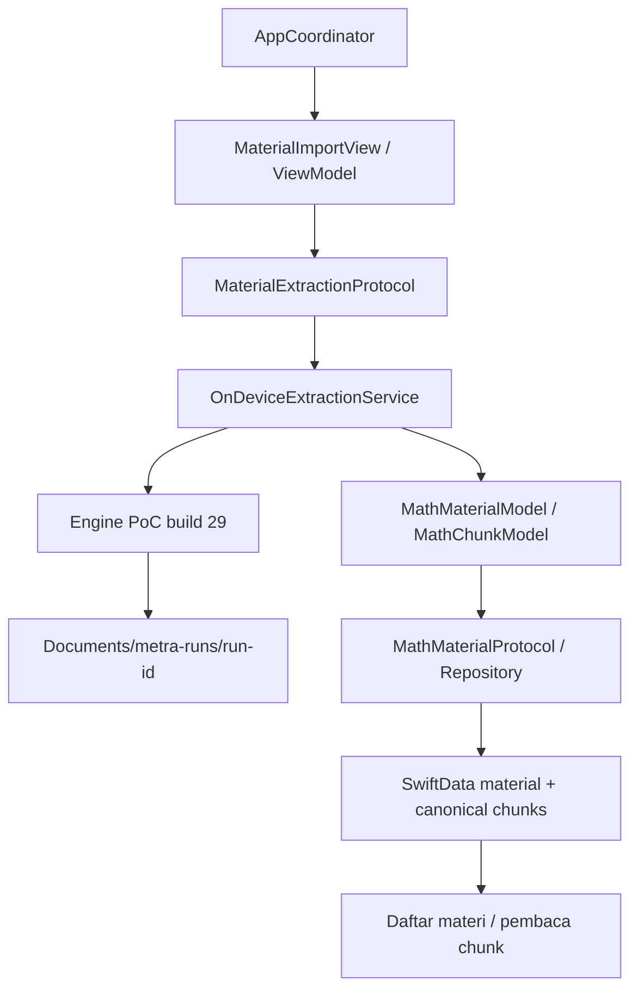

# Integrasi pipeline PoC ke Metra

Branch: `feat/poc-integration`, berangkat dari commit `5c5a785`.

## Yang tersedia

Beranda membuka alur **Tambah materi**. Pengguna dapat memilih gambar dari Photos (representasi current), mengambil foto, mengurutkan halaman, memberikan judul, lalu memproses dan menyimpan materi. Ekstraksi menggunakan profil serial dan berjalan lokal pada iPhone. Halaman materi menampilkan daftar topik. Setiap topik membuka bacaan chunk dengan tombol topik sebelumnya/berikutnya di atas. UI pengguna tidak menampilkan penanda review, nomor bagian, teks sumber, atau toolbar diagnostik. Raw/status/preview asli dan JSON laporan tetap tersimpan; daftar materi membaca hasil melalui repository SwiftData. Lihat [eksperimen topik dan bukti perangkat](TOPIC-NAVIGATION.md).

Implementasi ini membawa engine **PoC build 29**, termasuk dispatch MathJax yang mengembalikan null agar Promise tidak dikirim sebagai hasil native. App Metra memakai bundle `id.birumerah.Metra`, versi 1.0 build 27; nomor itu berbeda dari nomor build PoC sumber. Build 3 menyertakan Qwen dalam bundle sesuai permintaan pengguna, sehingga tidak memerlukan impor model di iPhone. Build 10 menambahkan crop nilai+satuan berpangkat serta validasi hasil; [riwayatnya](UNIT-POWERS.md). Build 14 menggabungkan kandidat crop Pix2Text-MFD dengan DocLayout/Vision menuju UniMERNet; [hasil pilot dan batasnya](MFD-CROP-MERGE.md). Build 15 menambahkan pilot Debug Foundation Models: generasi Indonesia berhasil di iPhone dengan bahasa utama English; topik dan relasi diagram belum lolos validasi. [Hasil pilot](FOUNDATION-MODELS.md). Build 16 menormalkan struktur soal/pilihan dan satuan berpangkat dengan jejak sumber; pada satu uji iPhone, 24 pilihan A–B–C–D dan 8/8 satuan ready. [Hasil normalisasi dan JSON v4](READING-NORMALIZATION.md). Build 17 mengganti runtime diagram menjadi Apple Foundation Models lokal dan mengeluarkan Qwen/MLX dari build. Lihat [migrasi dan hasil uji](FOUNDATION-DIAGRAM.md). Source fingerprint ada pada `poc-source.json`. Eksperimen dan output PoC asli tidak dimodifikasi.

## Batas antar layer



- ViewModel dan Coordinator menggunakan `@Observable`/`@MainActor`. View menyimpan ViewModel pada `@State` agar state input tidak berganti saat view dibentuk ulang.
- Engine lama ditempatkan pada `Metra/Data/Extraction/Engine`. `ObservableObject`/Combine di sana merupakan adapter legacy internal, bukan state UI baru.
- `OnDeviceExtractionService` membatasi satu operasi, mengimpor sumber, menunggu terminal state engine, dan memetakan kontrak hasil ke domain. Domain tidak mengekspos entitas SwiftData atau tipe runtime model.
- Model global default actor isolation dibuat nonisolated agar value contracts dan actor engine mempertahankan isolasi PoC. ViewModel, Coordinator, service dan repository tetap secara eksplisit MainActor.
- Adaptasi engine dicatat di manifest. Integrasi awal: `ImageIngestor` menerima JPEG kamera yang sudah di-encode sekali oleh adapter UI; `ModelAssetManager` kini memeriksa ketersediaan model sistem Apple dan kapabilitas vision; impor checkpoint eksternal tidak dipakai lagi. Build 9 juga membawa perbaikan tampilan ID dan kandidat merge region formula bersarang; [status validasi dan batasnya](FORMULA-MERGE.md).
- Thumbnail input maksimum 160 piksel; gambar penuh dan byte sumber tidak diganti thumbnail saat inference.

## Penyimpanan dan identitas

- `MathMaterialModel.id` memakai UUID run, bukan UUID baru ketika mencoba simpan ulang.
- `MathChunkEntity.storageID` adalah `<material UUID>:<source chunk ID>`. ID seperti `p0001.layout...` dapat berulang pada run lain tanpa bertabrakan.
- Urutan canonical `chunks[]` disimpan sebagai `order`; source ID, page ID, kind, status, source text, spoken text, spoken preview, unresolved IDs, uncertainty, source ref dan image path dipertahankan.
- `topicIndex` disimpan sebagai JSON reference-only. Material baru mengikuti judul/subjudul sumber, dengan judul materi sebagai fallback. Index Qwen lama tetap dapat dibaca, tidak dibuat ulang saat membuka materi. Chunk tidak digandakan; `final_ready.json` tetap immutable.
- `spokenText == nil` tetap nil. Preview review tidak dipromosikan menjadi spoken lengkap atau status ready.
- Raw OCR, LaTeX, MathML, MathCAT, diagram, crop, manifest dan metrik tetap berada pada folder run. SwiftData menyimpan data untuk pembaca dan referensi JSON lengkap, bukan salinan bobot model atau seluruh raw artifacts.
- Penyimpanan run yang sama bersifat upsert. Kegagalan save melakukan rollback; ViewModel menawarkan simpan ulang hasil yang sudah dibuat tanpa mengulang inference.
- Penghapusan materi menerapkan cascade untuk chunk SwiftData. Folder raw run tetap ada untuk provenance.
- Penambahan field material bersifat opsional dan relationship chunks mempunyai default kosong, agar record lama yang hanya memiliki judul tetap dapat dibaca. Migrasi pada database perangkat yang sudah ada belum diuji.
- Jika store tidak dapat dibuka, app menampilkan error dan mempertahankan store. Tidak ada penghapusan database atau fallback in-memory yang mengaku menyimpan secara persisten.

## Menyiapkan model dan build

Target app yang sudah ada memakai **iOS 27.0**. Integrasi ini mempertahankan deployment target tersebut. Gunakan Xcode 27 dan destination iPhone fisik. Library MathCAT yang tersedia hanya arm64 iOS device; simulator belum dipaketkan.

Empat ONNX hasil ekspor awal berjumlah 887,354,437 byte. Pix2Text-MFD menambah 44,573,224 byte, total lima ONNX 931,927,661 byte. PP-OCRv5 mobile recognition menambah 16,534,782 byte, sehingga enam ONNX berjumlah 948,462,443 byte. Qwen tidak dibundel sejak build 17. Checkpoint dan sumber lamanya disimpan lokal di `legacy-qwen-build16/` di luar source/resource target. File model besar tidak masuk Git. Metadata, MathJax, rules, prompt dan library MathCAT native ada di repo. Pada workspace ini seluruh aset sudah disiapkan. Untuk MFD pada clone baru, jalankan `python3 Tools/prepare-mfd-assets.py --download` atau berikan `--source /path/to/mfd-v20240618.onnx`; setelah itu persiapkan aset PoC/cache lokal yang dipertahankan:

```sh
python3 Tools/prepare-poc-assets.py --source ../Approach-Latest-Metra
```

Siapkan juga PaddleOCR resmi yang dipin dengan `python3 Tools/prepare-paddle-ocr-assets.py --download` atau `--source /path/to/inference.onnx`. Bobot berukuran 16.5 MB; config dan kamus CTC ada di repo. Tidak ada inference di Mac. [Jalur simbol dan hasil pilot PaddleOCR](PADDLEOCR.md).

Path `--source` boleh berbeda, dengan struktur `MetraPipelinePoC/Resources` yang sama. Script menyalin dan memverifikasi aset ONNX lokal. Tidak ada unduhan atau persiapan Qwen dalam workflow aktif. Dependency Swift aktif hanya ONNX Runtime 1.24.2; MathCAT native 0.7.5 dan aturan Indonesia tetap dipakai. Foundation Models disediakan iOS, memerlukan Apple Intelligence yang siap serta kapabilitas vision. Ketersediaan bahasa Indonesia dilaporkan, bukan dijadikan gate karena pilot perangkat dengan system English berhasil menghasilkan Indonesia.

Build untuk device SDK tanpa signing:

```sh
DEVELOPER_DIR=/Applications/Xcode.app/Contents/Developer xcodebuild \
  -project Metra.xcodeproj -scheme Metra -configuration Debug \
  -sdk iphoneos -destination 'generic/platform=iOS' \
  CODE_SIGNING_ALLOWED=NO build
```

Untuk menjalankan di iPhone, pilih signing team yang tersedia pada Xcode. Checkout saat ini memakai team `U3CC574JGM` yang dipilih pada project Xcode; anggota tim lain memilih signing team yang tersedia pada Mac mereka. Konfigurasi camera usage, CFBundleExecutable, file sharing dan build metadata berada pada `Configuration/Info.plist` serta build settings.

### Model diagram

Apple `SystemLanguageModel.default` menerima crop asli, OCR Vision, nilai rumus yang siap, dan konteks sumber terdekat. Hasil `@Generable` membatasi referensi titik dan nilai. Relasi sudut harus cocok dengan notasi sudut/nilai dari konteks asli; MathCAT membacakan MathML nilainya. Overview dan ruas garis dari gambar tetap kandidat model, belum menjadi audit akurasi umum. Raw respons, transcript, metadata OS/model, evidence, penolakan validasi dan waktu request disimpan. Tidak ada provider cloud atau PCC fallback.

Jika model sistem belum tersedia, OCR dan rumus tetap berjalan, sementara deskripsi diagram dilaporkan gagal beserta penyebab. Model sistem tidak dapat dipin hash/checkpoint atau diklaim di-unload oleh aplikasi.

## Bukti dan status

`verification/` di folder ini adalah hasil lokal yang diabaikan Git: log build, pemeriksaan bundle dan status. Status yang dapat dibagikan ada pada `status.json`.

Build SDK iPhone dan pemeriksaan bundling tidak membuktikan inference, migrasi database, UI, atau save/reopen pada perangkat. Tidak ada test suite ditambahkan. Eksperimen topik Qwen di app Metra dijalankan pada iPhone; laporan dan batas bukti ada di TOPIC-NAVIGATION.md. OCR/rumus/diagram tidak dijalankan ulang pada eksperimen topik ini. Sembilan uji iPhone build 29 sebelumnya merupakan bukti engine PoC, bukan bukti end-to-end app Metra.

Pemeriksaan berikutnya melalui UI: pastikan status model Apple tersedia, proses gambar diagram, lalu pilih materi_003 dan periksa lima baris di bacaan, simpan/buka ulang setelah restart dan batch dua halaman. Status kelengkapan/akurasi sumber dan diagram tetap mengikuti review pipeline; tidak ada klaim Handbook, TTS atau learning assistant dari integrasi ini.

Run build 9 yang dijalankan pengguna menunjukkan sudut AOB/COD berstatus ready dan masing-masing memiliki satu source slice pada bacaan; deteksi gabungan dipertahankan sebagai alias tanpa bacaan kedua. Ini bukti satu halaman, bukan pengukuran stabilitas ulang atau akurasi semua formula. Kegagalan audit build 7 tetap dipertahankan. Lihat `formula-overlap-results.json`.

Perbaikan satuan build 10 berhasil build/sign/install. Pengguna memilih menjalankan sendiri, sehingga aplikasi tidak dibuka dan inference/fixture baru tidak dijalankan oleh agent. Impor ulang gambar sebagai materi baru untuk memeriksa hasil crop dan spoken satuan. Lihat [UNIT-POWERS.md](UNIT-POWERS.md) dan `unit-powers-status.json`.

Pilot baru build 12–14 atas permintaan pengguna menambahkan MFD dan menjalankan dua ekstraksi pada gambar lampiran baru (resolusi berbeda dari run build 9/10). Build 14 menyimpan dua crop MFD ready tepat sekali, mempertahankan 88 sebagai teks, dan meloloskan 6 dari 8 rentang satuan lewat jalur gabungan/yang sudah ada. Hasil awal build 13 yang salah tetap disimpan. Ini tidak membuktikan akurasi seluruh halaman atau menyelesaikan diagram. Lihat [MFD-CROP-MERGE.md](MFD-CROP-MERGE.md).

Uji konsistensi kecil build 19: tiga run baru pada satu gambar/iPhone menghasilkan OCR, 35 region rumus, crop dan struktur chunk/topik yang sama; diagram mempunyai dua versi bacaan. Prompt berubah karena urutan key JSON, sehingga belum menjadi bukti determinisme Foundation pada prompt byte-identik. [Metode, hasil dan batas bukti](CONSISTENCY.md).

Build 20 memperbaiki serialisasi prompt dengan sorted keys, source-order tie-break dan fingerprint request. Tiga run baru menghasilkan prompt, parsed JSON diagram, bacaan dan final_ready yang sama setelah metadata run diabaikan; akurasi diagram tetap parsial. [Perbaikan dan bukti iPhone](CONSISTENCY-FIX.md).

Build 21–23 menambahkan proposal crop dari Unicode OCR menuju UniMERNet–MathJax–MathCAT, binding tanda baca yang berbagi box Vision dan pemeriksaan basis pangkat. Pilot build 21 pada satu gambar/iPhone menghasilkan tujuh dari delapan crop Unicode lolos validator; satu kasus koma diperbaiki dan lolos pemeriksaan artefak tersimpan. Build 23 berhasil dibangun, belum dipasang/diuji di perangkat. Pada eksperimen build 21–23 ini belum ada PaddleOCR atau model baru. [Implementasi, bukti dan batas uji](UNICODE-MATH.md).

Build 24–25 menambahkan PP-OCRv5 mobile resmi sebagai text recognizer native pada baris Vision yang mempunyai petunjuk matematika. Kandidat Vision asli tetap disimpan, dengan pilihan Unicode serta artifact terpisah. Build 25 memilih simbol di atas ambang secara individual; perbedaan prosa/angka tetap menahan seluruh perubahan baris. Ini belum menambahkan detector Paddle satu halaman. [Implementasi dan bukti perangkat](PADDLEOCR.md).

Build 26 menurunkan ambang simbol Paddle dari 0.85 ke 0.70 dan memperluas veto MFD untuk label pilihan Kiril homoglyph bertanda titik/kurung. Satu uji baru memakai byte gambar asli dari run pengguna: DFE/DPE menjadi bacaan sudut ready, kandidat A. tidak menjadi chunk rumus, delapan bacaan satuan kuadrat dan enam set A–D tetap terjaga. Halaman tetap partial. [Perbaikan dan bukti iPhone](READER-SYMBOL-FIX.md).

Build 27 menggabungkan nomor soal terkonfirmasi yang terpisah oleh sentence tokenizer dengan kalimat pertama di blok sumber yang sama. Chunk awal memakai kind question_start dan label VoiceOver “Soal 33. …”; kalimat lanjutan serta pilihan tetap terpisah. Build/sign/install berhasil; hasil runtime dan interaksi VoiceOver baru belum diuji. Impor ulang sebagai materi baru untuk memakai susunan baru. [Aturan dan batas bukti](QUESTION-START.md).
