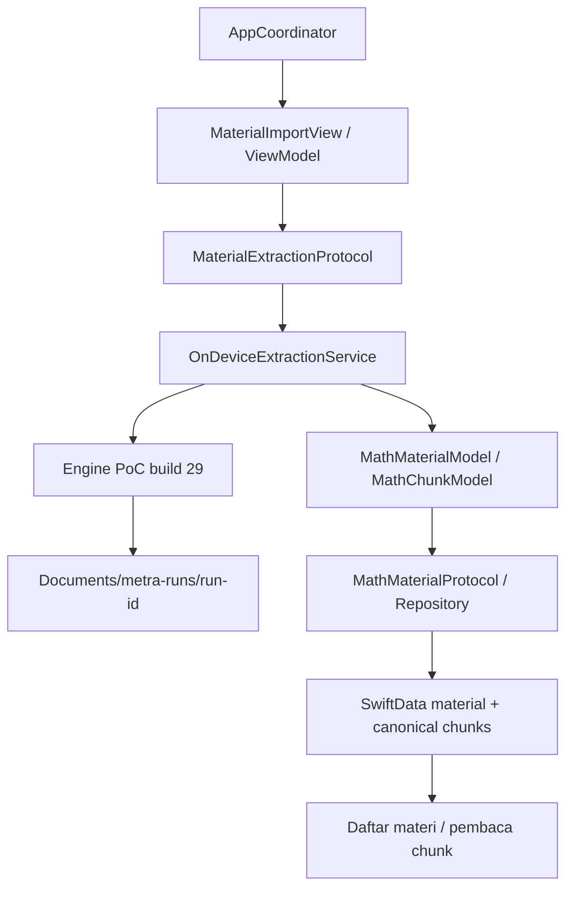

# Integrasi pipeline PoC ke Metra

Branch: `feat/poc-integration`, berangkat dari commit `5c5a785`.

## Yang tersedia

Beranda membuka alur **Tambah materi**. Pengguna dapat memilih gambar dari Photos (representasi current), mengambil foto, mengurutkan halaman, memberikan judul, lalu memproses dan menyimpan materi. Ekstraksi menggunakan profil serial dan berjalan lokal pada iPhone. Halaman materi menampilkan daftar topik. Setiap topik membuka bacaan chunk dengan tombol topik sebelumnya/berikutnya di atas. UI pengguna tidak menampilkan penanda review, nomor bagian, teks sumber, atau toolbar diagnostik. Raw/status/preview asli dan JSON laporan tetap tersimpan; daftar materi membaca hasil melalui repository SwiftData. Lihat [eksperimen topik dan bukti perangkat](TOPIC-NAVIGATION.md).

Implementasi ini membawa engine **PoC build 29**, termasuk dispatch MathJax yang mengembalikan null agar Promise tidak dikirim sebagai hasil native. App Metra memakai bundle `id.birumerah.Metra`, versi 1.0 build 10; nomor itu berbeda dari nomor build PoC sumber. Build 3 menyertakan Qwen dalam bundle sesuai permintaan pengguna, sehingga tidak memerlukan impor model di iPhone. Build 10 menambahkan crop nilai+satuan berpangkat serta validasi hasil; [status dan batas bukti](UNIT-POWERS.md). Source fingerprint ada pada `poc-source.json`. Eksperimen dan output PoC asli tidak dimodifikasi.

## Batas antar layer



- ViewModel dan Coordinator menggunakan `@Observable`/`@MainActor`. View menyimpan ViewModel pada `@State` agar state input tidak berganti saat view dibentuk ulang.
- Engine lama ditempatkan pada `Metra/Data/Extraction/Engine`. `ObservableObject`/Combine di sana merupakan adapter legacy internal, bukan state UI baru.
- `OnDeviceExtractionService` membatasi satu operasi, mengimpor sumber, menunggu terminal state engine, dan memetakan kontrak hasil ke domain. Domain tidak mengekspos entitas SwiftData atau tipe runtime model.
- Model global default actor isolation dibuat nonisolated agar value contracts dan actor engine mempertahankan isolasi PoC. ViewModel, Coordinator, service dan repository tetap secara eksplisit MainActor.
- Adaptasi engine dicatat di manifest. Integrasi awal: `ImageIngestor` menerima JPEG kamera yang sudah di-encode sekali oleh adapter UI; `ModelAssetManager` menyediakan API impor async dan pemilihan model bundle dengan pin/hash yang sama. Build 9 juga membawa perbaikan tampilan ID dan kandidat merge region formula bersarang; [status validasi dan batasnya](FORMULA-MERGE.md).
- Thumbnail input maksimum 160 piksel; gambar penuh dan byte sumber tidak diganti thumbnail saat inference.

## Penyimpanan dan identitas

- `MathMaterialModel.id` memakai UUID run, bukan UUID baru ketika mencoba simpan ulang.
- `MathChunkEntity.storageID` adalah `<material UUID>:<source chunk ID>`. ID seperti `p0001.layout...` dapat berulang pada run lain tanpa bertabrakan.
- Urutan canonical `chunks[]` disimpan sebagai `order`; source ID, page ID, kind, status, source text, spoken text, spoken preview, unresolved IDs, uncertainty, source ref dan image path dipertahankan.
- `topicIndex` disimpan sebagai JSON reference-only pada material. Eksperimen Qwen text-only memberi judul dan keanggotaan chunk; kode memvalidasi coverage tepat sekali dan urutan. Chunk tidak digandakan. `final_ready.json` hasil engine tetap immutable; index navigasi Qwen ada dalam SwiftData dan artefak percobaan terpisah.
- `spokenText == nil` tetap nil. Preview review tidak dipromosikan menjadi spoken lengkap atau status ready.
- Raw OCR, LaTeX, MathML, MathCAT, diagram, crop, manifest dan metrik tetap berada pada folder run. SwiftData menyimpan data untuk pembaca dan referensi JSON lengkap, bukan salinan bobot model atau seluruh raw artifacts.
- Penyimpanan run yang sama bersifat upsert. Kegagalan save melakukan rollback; ViewModel menawarkan simpan ulang hasil yang sudah dibuat tanpa mengulang inference.
- Penghapusan materi menerapkan cascade untuk chunk SwiftData. Folder raw run tetap ada untuk provenance.
- Penambahan field material bersifat opsional dan relationship chunks mempunyai default kosong, agar record lama yang hanya memiliki judul tetap dapat dibaca. Migrasi pada database perangkat yang sudah ada belum diuji.
- Jika store tidak dapat dibuka, app menampilkan error dan mempertahankan store. Tidak ada penghapusan database atau fallback in-memory yang mengaku menyimpan secara persisten.

## Menyiapkan model dan build

Target app yang sudah ada memakai **iOS 27.0**. Integrasi ini mempertahankan deployment target tersebut. Gunakan Xcode 27 dan destination iPhone fisik. Library MathCAT yang tersedia hanya arm64 iOS device; simulator belum dipaketkan.

Empat ONNX hasil ekspor berjumlah 887,354,437 byte. Bobot Qwen berjumlah 1,782,040,921 byte, ditambah tokenizer/config sekitar 16 MB. File model besar dan folder Qwen hasil persiapan tidak masuk Git. Metadata, MathJax, rules, prompt dan library MathCAT native ada di repo. Persiapkan aset di Mac dari PoC/cache lokal yang dipertahankan:

```sh
python3 Tools/prepare-poc-assets.py --source ../Approach-Latest-Metra
```

Path `--source` boleh berbeda, dengan struktur `MetraPipelinePoC/Resources` yang sama. Script hanya menyalin dan memverifikasi hash/ukuran; tidak melakukan inference, conversion atau download. Untuk Qwen, ia memakai bundle lokal yang sudah valid, snapshot cache Hugging Face revision yang dipin, atau folder transfer PoC yang sudah disiapkan di Mac ini. Folder sumber Qwen juga dapat ditentukan:

```sh
python3 Tools/prepare-poc-assets.py --qwen-source /path/to/Qwen3-VL-2B-4bit
```

Jika hanya menyiapkan Qwen: `python3 Tools/prepare-qwen-bundle.py --source /path/to/checkpoint`. Script memverifikasi 14 file dengan `qwen-bundle-assets.json`, menyalin isi symlink sebagai file biasa, dan mengaktifkan folder lengkap setelah seluruh hash cocok. Folder akhirnya adalah `Resources/Qwen3-VL-2B-4bit`, direferensikan sebagai folder resource Xcode. Pada workspace ini aset sudah disiapkan; build berikutnya langsung menyertakannya. Mac baru/clone baru tetap memerlukan aset lokal sebelum build, bukan impor di iPhone.

Swift package dipin sama dengan PoC: mlx-swift 0.32.3, mlx-swift-lm 3.32.3, ONNX Runtime 1.24.2, Transformers 1.3.5, HuggingFace 0.13.0 dan transitive pins dalam Package.resolved. MathCAT native 0.7.5 dan aturan Bahasa Indonesia tetap sama.

Build untuk device SDK tanpa signing:

```sh
DEVELOPER_DIR=/Applications/Xcode.app/Contents/Developer xcodebuild \
  -project Metra.xcodeproj -scheme Metra -configuration Debug \
  -sdk iphoneos -destination 'generic/platform=iOS' \
  CODE_SIGNING_ALLOWED=NO build
```

Untuk menjalankan di iPhone, pilih signing team yang tersedia pada Xcode. Team repo (`96SXDK9ZFJ`) dipertahankan; build lokal unsigned tidak mengubah team anggota tim. Konfigurasi camera usage, CFBundleExecutable, file sharing dan build metadata berada pada `Configuration/Info.plist` serta build settings.

### Model diagram

Qwen dibundel langsung pada app build 3: checkpoint `mlx-community/Qwen3-VL-2B-Instruct-4bit`, revision `9c4f5209e57b31f4b9dfba735de3fb983739c9cc`. Hash bobot `4750d95a2162829e127a94e83ac350d498d02070aab216c4687da48804a06ffb` tidak berubah. Tidak ada download atau model alternatif.

Saat app dibuka, manager memilih folder bundle, memeriksa manifest/pin/config/ukuran, dan menampilkan bahwa model disertakan. Hash seluruh file diperiksa secara streaming pada background task sebelum ekstraksi pertama, kemudian hasil verifikasi dipakai ulang dalam proses app yang sama. Tidak ada salinan 1,8 GB tambahan ke Application Support. Loader MLXVLM/tokenizer memakai jalur folder lokal. Tombol impor disembunyikan jika bundle valid; importer tetap tersedia sebagai fallback saat model bawaan tidak tersedia. Pemeriksaan gagal menonaktifkan Qwen dan menyimpan laporan, sementara teks/rumus tetap dapat dilanjutkan.

Ukuran instalasi dan waktu build/transfer meningkat karena model disertakan. Verifikasi hash juga menambah I/O sebelum ekstraksi pertama; biaya perangkatnya belum diukur. Ini terpisah dari waktu load/inference yang dilaporkan runtime.

## Bukti dan status

`verification/` di folder ini adalah hasil lokal yang diabaikan Git: log build, pemeriksaan bundle dan status. Status yang dapat dibagikan ada pada `status.json`.

Build SDK iPhone dan pemeriksaan bundling tidak membuktikan inference, migrasi database, UI, atau save/reopen pada perangkat. Tidak ada test suite ditambahkan. Eksperimen topik Qwen di app Metra dijalankan pada iPhone; laporan dan batas bukti ada di TOPIC-NAVIGATION.md. OCR/rumus/diagram tidak dijalankan ulang pada eksperimen topik ini. Sembilan uji iPhone build 29 sebelumnya merupakan bukti engine PoC, bukan bukti end-to-end app Metra.

Pemeriksaan perangkat berikutnya melalui UI: pastikan model bawaan ditampilkan tanpa impor, proses gambar diagram, lalu pilih materi_003 dan periksa lima baris di bacaan, simpan/buka ulang setelah restart dan batch dua halaman. Status kelengkapan/akurasi sumber dan diagram tetap mengikuti review pipeline; tidak ada klaim Handbook, TTS atau learning assistant dari integrasi ini.

Run build 9 yang dijalankan pengguna menunjukkan sudut AOB/COD berstatus ready dan masing-masing memiliki satu source slice pada bacaan; deteksi gabungan dipertahankan sebagai alias tanpa bacaan kedua. Ini bukti satu halaman, bukan pengukuran stabilitas ulang atau akurasi semua formula. Kegagalan audit build 7 tetap dipertahankan. Lihat `formula-overlap-results.json`.

Perbaikan satuan build 10 berhasil build/sign/install. Pengguna memilih menjalankan sendiri, sehingga aplikasi tidak dibuka dan inference/fixture baru tidak dijalankan oleh agent. Impor ulang gambar sebagai materi baru untuk memeriksa hasil crop dan spoken satuan. Lihat [UNIT-POWERS.md](UNIT-POWERS.md) dan `unit-powers-status.json`.
