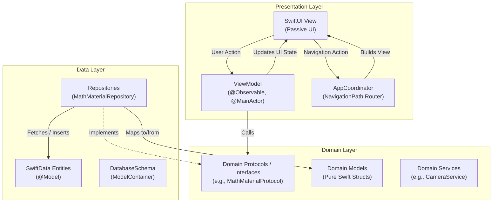

## 📌 Project Overview

### Integrasi PoC aktif

Branch `feat/poc-integration` membawa engine PoC build 29 ke alur galeri/kamera, daftar topik, pembaca chunk untuk VoiceOver dan penyimpanan SwiftData. Siapkan aset lokal dengan `python3 Tools/prepare-poc-assets.py`, lalu buka `Metra.xcodeproj`. Build 17 memakai Apple Foundation Models lokal untuk diagram; Qwen dan dependency MLX sudah dikeluarkan dari aplikasi. Material baru memakai judul/subjudul sumber untuk navigasi topik. Hasil pengguna build 9 menunjukkan merge kedua sudut dan deduplikasi pada satu halaman; [status formula](Integration/FORMULA-MERGE.md). Build 10 menambahkan crop nilai+satuan berpangkat dan validasi hasil, sudah build/install, menunggu uji pengguna; [status satuan](Integration/UNIT-POWERS.md). [Arsitektur, persiapan aset, build dan batas bukti](Integration/README.md).

**Build 14** menambahkan Pix2Text-MFD sebagai sumber kandidat crop sebelum UniMERNet, dengan merge dan jejak sumber. Sudah diuji pada iPhone: dua crop MFD ready tepat sekali, 88 tetap teks biasa, dan 6/8 rentang satuan ready dari jalur gabungan/yang sudah ada. Hasil masih parsial; diagram dan akurasi umum belum selesai dinilai. [Hasil dan persiapan aset MFD](Integration/MFD-CROP-MERGE.md).

**Build 15** memuat eksperimen Debug Apple Foundation Models on-device. Dua permintaan Indonesia berhasil dengan bahasa utama English pada iPhone 17, iOS 27.0.1. Pilot topik menghasilkan referensi yang tidak valid; deskripsi diagram salah menempatkan satu sudut. Itu hasil historis sebelum migrasi produksi build 17. [Respons mentah, waktu dan batas bukti](Integration/FOUNDATION-MODELS.md).

**Build 16** menormalkan pilihan A–B–C–D per soal menjadi satu chunk per pilihan, serta menambahkan grouping/intent satuan dengan validasi sumber sebelum MathCAT. Satu uji iPhone pada gambar yang sama menghasilkan 24 pilihan ready dan 8/8 satuan berpangkat ready, termasuk 616/324 cm². Raw OCR, raw LaTeX dan source refs tetap sama. [Hasil, JSON v4 dan batas normalisasi](Integration/READING-NORMALIZATION.md). Itu ukuran build 16 sebelum penghapusan Qwen pada build 17.

**Build 17–19** mengganti diagram ke Foundation Models dengan hasil terstruktur, validasi referensi/relasi sudut dan MathCAT untuk nilai. Qwen, safetensors dan dependency MLX tidak ada dalam bundle baru. [Implementasi, uji iPhone dan keterbatasan](Integration/FOUNDATION-DIAGRAM.md).

**Build 20** menstabilkan serialisasi evidence pada prompt Foundation. Pada tiga uji iPhone, prompt dan isi hasil akhir sama; diagram masih memiliki keterbatasan akurasi. [Hasil perbaikan konsistensi](Integration/CONSISTENCY-FIX.md).

**Metra** is developed as part of **Apple Developer Academy (Final Project)**. An intuitive, accessibility-first iOS application that helps blind students to learn and understand math materials easily. 

### 🛠 Tech Stack & Requirements
* **Platform:** iOS 27.0+ pada deployment target project saat ini
* **Language:** Swift 5.9+ / Swift 6 compatible
* **UI Framework:** SwiftUI
* **State Management:** Observation Framework (`@Observable`)
* **Persistence:** SwiftData
* **Architecture:** Clean Architecture + MVVM + Coordinator Pattern
* **IDE:** Xcode 27 untuk dependency pipeline saat ini

---

## 🏗 Architecture & Project Structure

The project follows **Clean Architecture** principles decoupled into four core layers, combined with **MVVM** and the **Coordinator Pattern** for decoupled navigation.

```
Setara/
├── App/                     # App lifecycle & Navigation
│   ├── MetraApp.swift       # Entry point & DI container
│   ├── AppCoordinator.swift # Centralized navigation router & view factory
│   ├── AppRoutes.swift      # Enum of app navigation routes
│   └── ContentView.swift    # Root container hosting NavigationStack
│
├── Presentation/            # User Interface (MVVM)
│   ├── Views/               # SwiftUI views (passive UI components)
│   │   ├── HomeView.swift
│   │   └── SavedMaterialView.swift
│   └── ViewModels/          # @Observable State holders & Presentation logic
│       └── SavedMaterialViewModel.swift
│
├── Domain/                  # Core Business Logic (Framework-independent)
│   ├── Models/              # Pure Swift domain models (e.g., MathMaterialModel)
│   ├── Protocols/           # Service & repository interfaces (e.g., MathMaterialProtocol)
│   └── Services/            # Domain use-case services (e.g., CameraService)
│
├── Data/                    # Data Sources & Persistence
│   ├── Entities/            # SwiftData @Model persistent entities
│   ├── Repositories/        # Implementations of Domain protocols
│   ├── Helpers/             # Schema definitions (DatabaseSchema.swift)
│   └── Managers/            # External data managers & API clients
│
└── Assets.xcassets/         # App icons, colors, and media assets
```

### Layer Responsibilities



1. **Presentation Layer:**
   - **Views:** Declarative SwiftUI views responsible strictly for layout and binding. They do not hold business logic or directly instantiate navigation destinations.
   - **ViewModels:** Decorated with `@Observable` and `@MainActor`. They handle presentation state, call Domain protocols, and expose clean properties to views.
   - **AppCoordinator:** Manages the `NavigationPath` and acts as a factory (`buildView(route:)`) to construct Views and inject their dependencies.

2. **Domain Layer:**
   - Pure Swift code with minimal external dependencies.
   - Defines **Protocols** (contracts) that Data layer components must implement.
   - Defines **Domain Models** (plain structs) used across Presentation and Domain logic.

3. **Data Layer:**
   - Implements Domain protocols (e.g., `MathMaterialRepository: MathMaterialProtocol`).
   - Defines `@Model` entities for SwiftData.
   - Handles data mapping between Database Entities and Domain Models (`toDomain()` and `from(domain:)`).

---

## 📜 Development & Coding Conventions

To ensure clean, maintainable, and readable code across the team, please follow these guidelines:

### 1. Code Style & MARK Comments
Organize files logically using `// MARK: -` sections:

```swift
final class ExampleViewModel {
    // MARK: - Published Properties
    var items: [ItemModel] = []
    var isLoading: Bool = false
    var errorMessage: String?
    
    // MARK: - Dependencies
    private unowned let coordinator: AppCoordinator
    private let service: ExampleProtocol
    
    // MARK: - Init
    init(coordinator: AppCoordinator, service: ExampleProtocol) {
        self.coordinator = coordinator
        self.service = service
    }
    
    // MARK: - Public Actions
    func loadData() { ... }
    
    // MARK: - Private Helpers
    private func sanitizeInput() { ... }
}
```

### 2. State & Concurrency Guidelines
* Always annotate ViewModels and Coordinator with `@Observable` and `@MainActor`.
* Avoid legacy `@Published` and `ObservableObject` unless interacting with legacy APIs.
* Use `@Bindable` in Views when binding two-way state to an `@Observable` ViewModel:
  ```swift
  struct SavedMaterialView: View {
      @Bindable var viewModel: SavedMaterialViewModel
      ...
  }
  ```

### 3. SwiftData Entity ↔ Domain Model Separation
Never pass SwiftData `@Model` classes directly to the UI/Presentation layer. Instead, use domain models and mapping functions:
```swift
// In Entity (Data layer):
func toDomain() -> MathMaterialModel { ... }
static func from(domain: MathMaterialModel) -> MathMaterialEntity { ... }
```

### 4. Navigation via Coordinator
Never use direct `NavigationLink(destination: NextView())` inside child views. Route via the coordinator:
```swift
// Trigger navigation:
coordinator.navigate(to: .savedMaterialList)

// Pop back:
coordinator.navigateBack()
```

---

## 🌿 Git & Collaboration Workflow

### 1. Branching Strategy
We use a feature-branch workflow:
* `master` / `main`: Production-ready, stable codebase.
* `development` (if configured): Active development integration branch.
* Feature branches: Branch off `master` (or `development`) using descriptive prefixes:
  - `feat/<feature-name>` (e.g., `feat/camera-ocr-scanning`)
  - `fix/<bug-name>` (e.g., `fix/swiftdata-duplicate-id`)
  - `refactor/<scope>` (e.g., `refactor/coordinator-routing`)
  - `ui/<screen-name>` (e.g., `ui/topic-card-component`)
  - `chore/<task>` (e.g., `chore/update-gitignore`)

### 2. Commit Message Convention
Follow [Conventional Commits](https://www.conventionalcommits.org/):
```
<type>(<scope>): <short description in imperative mood>
```
* **Types:**
  - `feat`: A new user-facing feature or domain capability.
  - `fix`: A bug fix.
  - `refactor`: Code change that neither fixes a bug nor adds a feature.
  - `style`: Formatting, whitespace, missing semicolons (no code logic changes).
  - `docs`: Documentation updates (README, comments).
  - `test`: Adding or updating test cases.
  - `chore`: Project configuration, Xcode project files, dependencies.
* **Examples:**
  - `feat(camera): implement frame capture in CameraService`
  - `fix(data): resolve model context crash on background thread`
  - `refactor(presentation): move SavedMaterialView into dedicated component`

### 3. Pull Request (PR) & Review Process
1. Before pushing:
   - Ensure the app builds without errors or warnings (`Cmd + B`).
   - For the extraction integration, verify on a physical iOS 27+ iPhone; the packaged MathCAT library has no simulator slice. Run tests when requested for the task.
   - Run `git status` to ensure accidental files (e.g., `.DS_Store`, local user schemes) are not staged.
2. Open a Pull Request:
   - Provide a concise description of what was changed and why.
   - Attach screenshots or screen recordings for any UI changes.
   - Tag at least one peer collaborator for review.
3. Merge:
   - Merge only after approval and resolving all review discussions.

---

## 🚀 Getting Started

### 1. Clone the Repository
```bash
git clone https://github.com/BiruMerah/Metra.git
cd Metra
```

### 2. Open Project in Xcode
```bash
open Metra.xcodeproj
```

### 3. Build & Run
1. Select a physical iPhone running **iOS 27.0+**, then choose an available signing team. The packaged MathCAT native library targets iOS device arm64.
2. Press `Cmd + R` or click the **Play** button in Xcode.

> [!NOTE]
> When testing camera functionality, use a physical iOS device configured for development, as the iOS Simulator has limited camera hardware capabilities.

---

## 👥 Contributors

* **Andito Rizkyka Rianto** 
* **Anggi Novitasari**
* **Fidel Fausta Cavell**
* **Valentino Hartanto**
